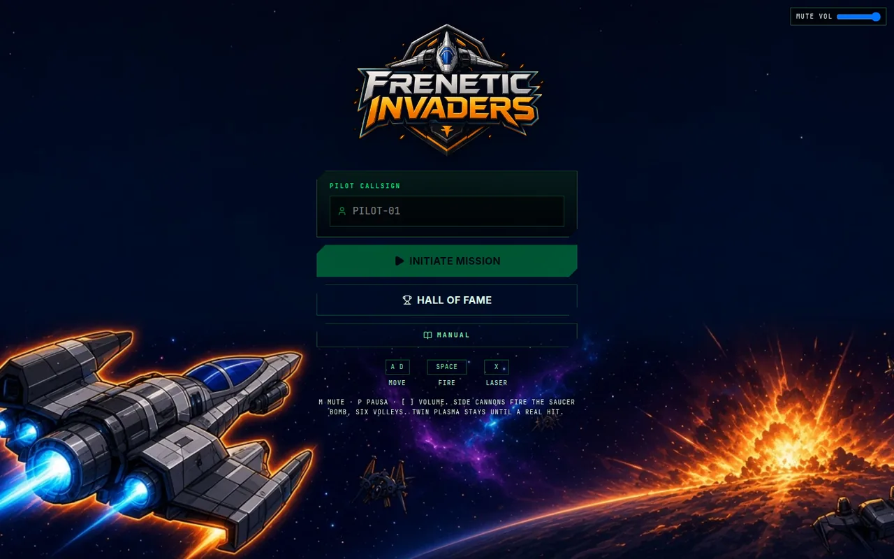
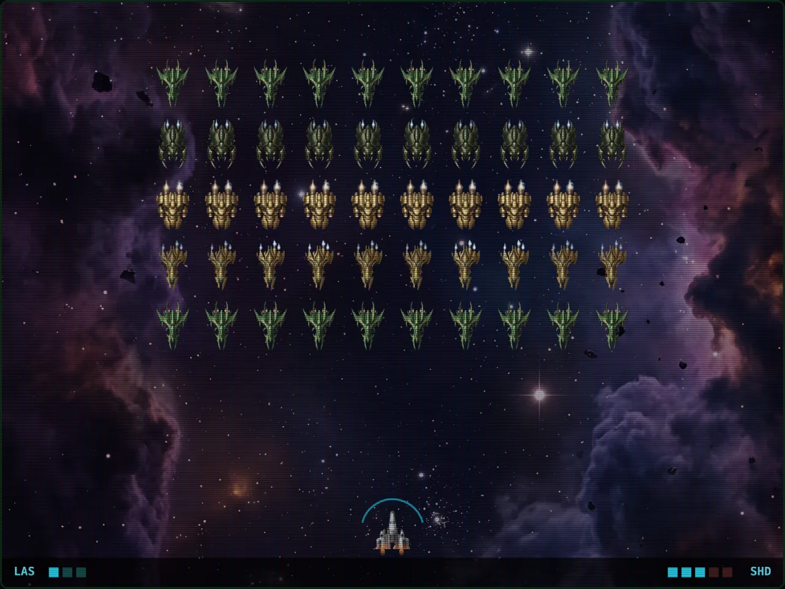

# Frenetic Invaders

Jogo de naves no navegador. Uma formação de 5 filas por 10 desce pela tela, a canhoneira atira por baixo e um disco cruza o alto soltando módulos. O placar vai para o Hall of Fame.

O manual completo está em [MANUAL.md](MANUAL.md). No jogo, o botão Manual abre a mesma leitura numa janela.

## Capturas





## Como rodar

É preciso Node.js e npm.

```bash
npm install
npm run dev
```

`npm run dev` executa `tsx server.ts`. O servidor escuta na porta 3000: [http://localhost:3000](http://localhost:3000).

## Controles

| Tecla | Ação |
|---|---|
| A, D ou setas | Move a nave na horizontal |
| Espaço | Tiro |
| X ou Shift | Laser. Gasta uma carga |
| P | Pausa e retoma a partida e o intervalo entre ondas |
| Espaço, de novo | No intervalo, começa a onda seguinte. É preciso soltar e apertar outra vez |
| M | Liga e desliga o som |
| [ e ] | Abaixa e aumenta o volume |

O callsign tem no máximo 10 letras. Initiate Mission começa a partida. Enter não inicia nem reinicia.

## O que tem no jogo

- Cada onda é uma formação de 5×10. São quatro naves inimigas, uma por fila, e a quinta fila repete a primeira. A onda seguinte gira qual fica no topo.
- O fundo troca a cada onda: nebulosa roxa, galáxia dourada e nebulosa azul, e depois recomeça. A lista está em `backgrounds`, dentro de [public/config/difficulty.json](public/config/difficulty.json).
- Esse JSON também ajusta a marcha, os tiros, as bombas e os mergulhos. Campo inválido ou arquivo ausente volta ao padrão do código.
- O disco soma pontos e solta um módulo: canhão lateral, tiro duplo ou escudo. O módulo seguinte, na mesma partida, nunca é do mesmo tipo.
- O canhão lateral vem desse módulo. São até dois, um de cada lado, com seis salvas no total. Cada salva sobe com a bomba do disco.
- O Hall of Fame guarda os placares e mostra os 100 maiores, com callsign, onda e pontos.
